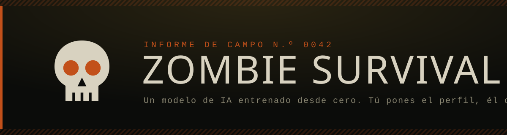
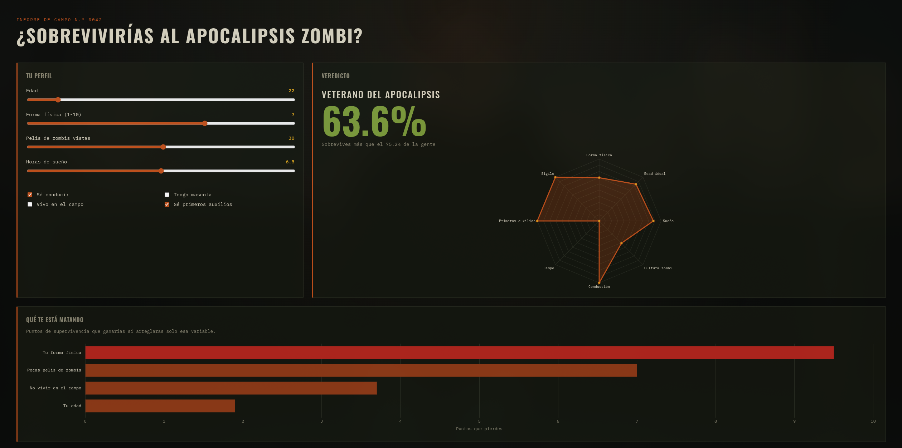

<div align="center">



<br><br>


<br>



</div>

<br>

<table>
<tr>
<td width="33%" valign="top">

### Modelo propio
Random Forest entrenado desde cero sobre 5.000 supervivientes simulados con reglas inventadas, relaciones no lineales y ruido. R² de 0,85.

</td>
<td width="33%" valign="top">

### Qué te mata
No solo te dice tu probabilidad: calcula cuántos puntos ganarías arreglando cada variable de tu perfil por separado.

</td>
<td width="33%" valign="top">

### Todo en local
Sin APIs externas, sin claves, sin cuentas. FastAPI, JavaScript vanilla y Chart.js.

</td>
</tr>
</table>

## Pruébalo

```bash
git clone https://github.com/TU_USUARIO/zombie-survival.git
cd zombie-survival

python3 -m venv .venv
source .venv/bin/activate        # fish: .venv/bin/activate.fish | Windows: .venv\Scripts\activate
pip install -r requirements.txt
mkdir -p data model

python generar_datos.py && python entrenar.py
uvicorn app:app --reload
```

Abre **http://127.0.0.1:8000** y a sobrevivir.

## Cómo está hecho

**Datos.** No existen datos reales de supervivencia zombi, así que `generar_datos.py` simula las variables, calcula una puntuación con reglas inventadas (por ejemplo `abs(edad - 30)`, para que lo ideal esté en el centro), le suma ruido gaussiano y la normaliza a 0-100. Con semilla fija, todo el mundo obtiene los mismos datos.

**Validación.** Las importancias del modelo coinciden con la contribución teórica de cada variable (coeficiente² × varianza): forma física 53 %, pelis de zombis 18 %, edad 10 %. El R² está limitado por el ruido que añadí a propósito.

**Qué te está matando.** Para cada variable se prueban todos sus valores con el resto del perfil fijo y se mide cuánto sube la predicción. Es un análisis contrafactual sencillo; la versión rigurosa serían los valores SHAP.

**Limitaciones.** El modelo no aprende la realidad, aprende mis reglas. Es divertido, no científico.

## Próximos pasos

- Valores SHAP en lugar del análisis contrafactual
- Comparar dos perfiles lado a lado
- Desplegarlo online

<br>

<div align="center">

Proyecto de portfolio · Desarrollo web + Especialidad en IA

</div>
